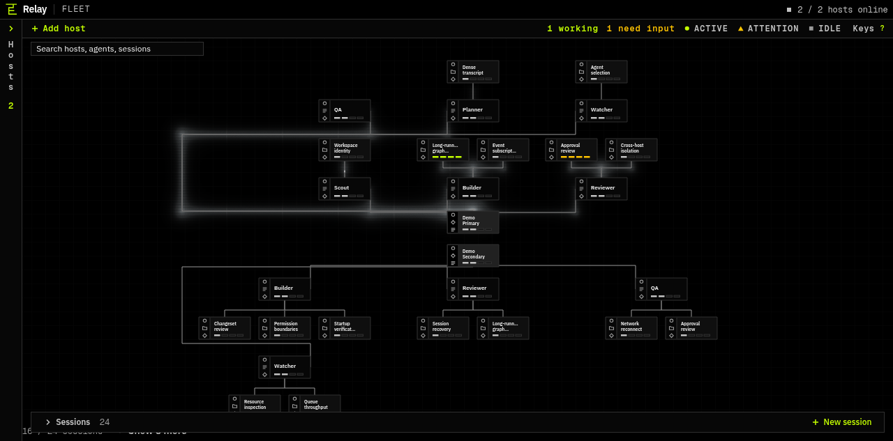

# AI-Relay

AI-Relay is a fleet console for the Agent Host Protocol (AHP) 1.0.
It shows hosts, providers, sessions, turns, approvals, and changesets.



## How it works

- AHP hosts own sessions and agent state.
- AI-Relay reads that state through the official AHP client.
- WebSocket transport carries live updates.
- ACP plugins connect hosts to agent backends.
- The browser keeps connection state in memory.
- The UI does not create a second session database.

The topology uses SVG for interaction and WebGL for the light field.
The optional native client uses Rust and GPUI.

## Start the demo

Requirements: Node.js 24 or newer.

```sh
npm ci
npm run demo
```

The demo creates disposable AHP hosts and synthetic ACP agents.
It fills the topology with realistic sessions and live status changes.
The command prints the local console address.

Stop the demo with:

```sh
npm run demo -- --stop
```

## Run the console

```sh
npm run console:check
npm run console:build
npm run console:start
```

The console reads the built files from `dist/`.
Use the address printed by `console:start`.

## Backend stack

| Layer | Technology |
| --- | --- |
| Protocol | Agent Host Protocol 1.0 |
| Agent bridge | Agent Client Protocol (ACP) |
| Client runtime | Node.js and JavaScript modules |
| Transport | WebSocket |
| Browser UI | Lit, SVG, CSS, and WebGL |
| Native UI | Rust and GPUI |
| Static server | Node.js HTTP server |

## Data flow

1. A host advertises providers and sessions.
2. AI-Relay subscribes to authoritative host state.
3. Host events update the fleet projection.
4. User actions go back through AHP.
5. The host performs the action and reports the result.

AI-Relay does not invent session state.
It does not run a second scheduler.

## Security model

- Hosts own access control and agent credentials.
- Client tokens stay in memory and private runtime state.
- Remote hosts should use encrypted WebSocket transport.
- Workspace trust is an explicit user action.
- The UI does not print or persist access tokens.

## Development checks

```sh
npm run console:check
npm run console:test
npm run test:relay
npm run typecheck
npm run build
```

The test suite uses isolated fixtures.
It does not require production agents or model accounts.

## Repository layout

- `ui/` — browser console and topology renderer
- `src/` — fleet state, graph projection, and React shell
- `native/` — Rust GPUI client
- `scripts/` — build, demo, and test commands
- `test/` — protocol, graph, and browser tests
- `deploy/` — service templates

## License

See [LICENSE](LICENSE).
